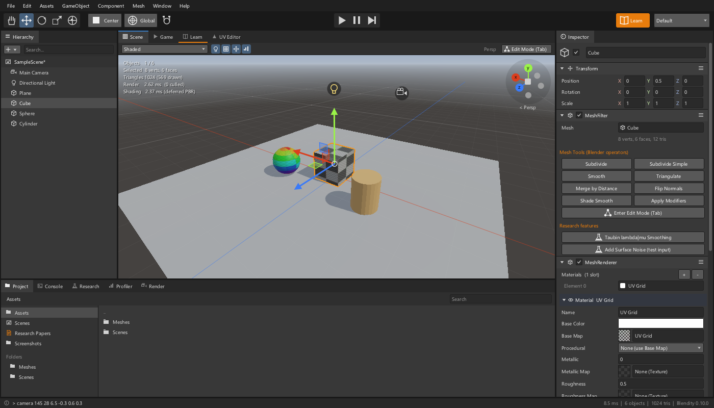
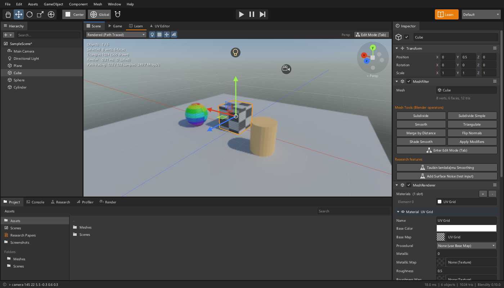
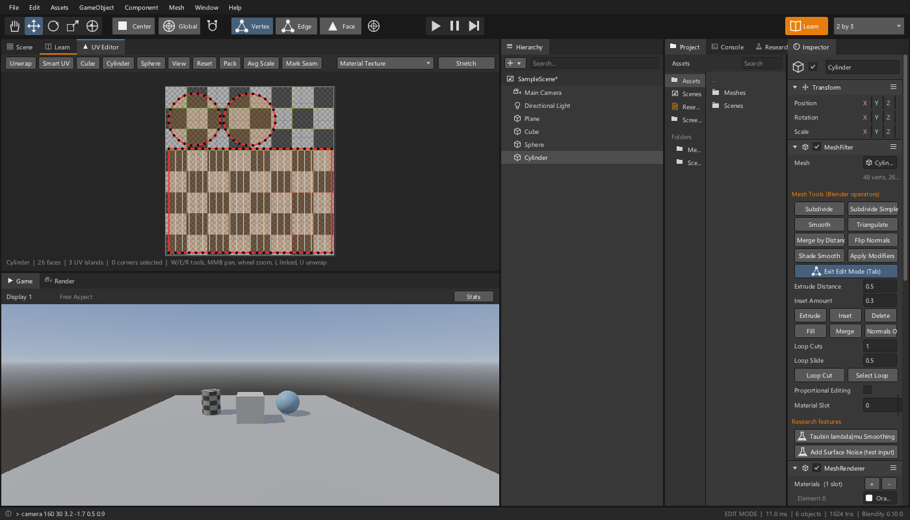
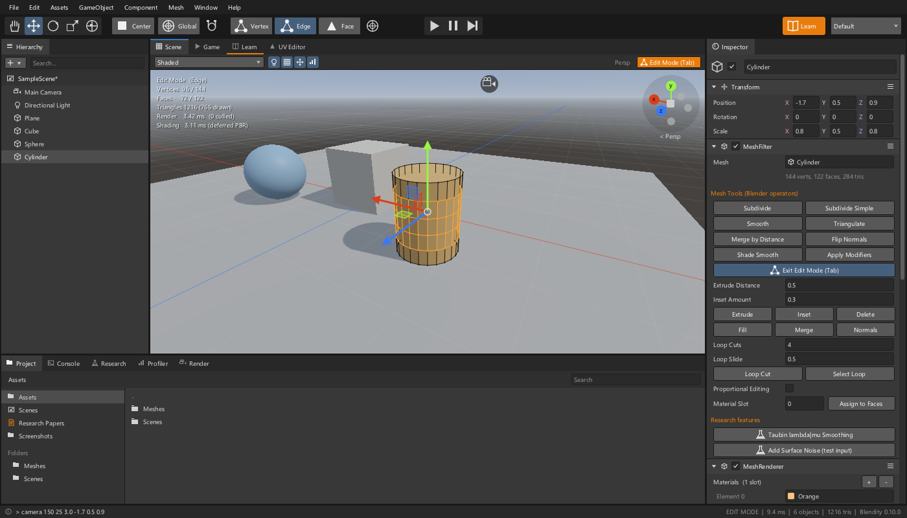
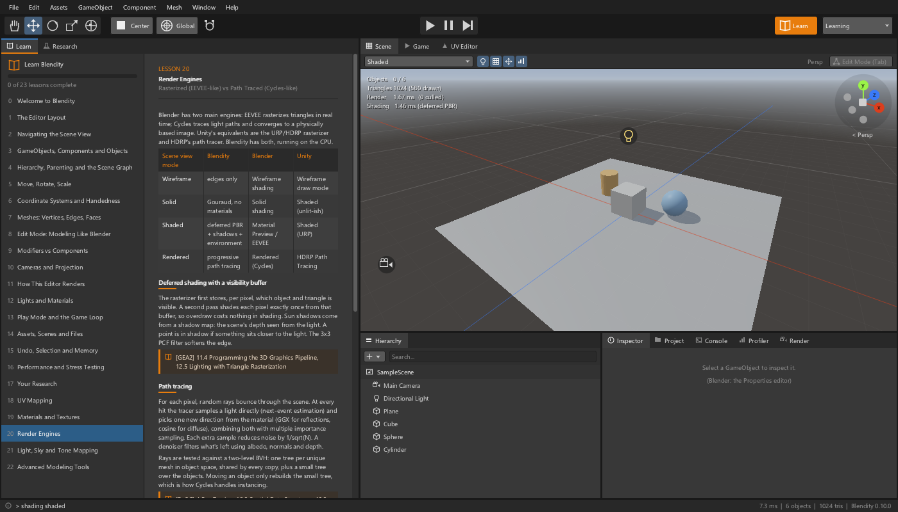

# Blendity

**Blender's modeling, UVs, materials, rendering, rigging and animation, driven like Unity.** Blendity is a 3D editor
written in C++17. Its windows, navigation, shortcuts, gizmos, Inspector and Play mode follow the Unity editor;
underneath, its meshes, Edit Mode tools, UV unwrapping, Principled materials, render engines (an EEVEE-like
rasterizer and a Cycles-like path tracer on the CPU and any Vulkan GPU), skins and IK follow Blender's design and
source code. A built-in **Learn** tab teaches each piece interactively.



| Path-traced viewport | UV Editor (LSCM unwrap) |
|---|---|
|  |  |
| **Edit Mode: loop cuts** | **Learn tab** |
|  |  |

**→ The [manual](docs/MANUAL.md)** walks through the work stage by stage, with examples.

## Download

Blendity is free. You don't need Blender or anything else: the installer brings everything Blendity uses.

> Blendity is a **pre-release** (0.10.0): it works, but it is still being refined, so expect rough edges. Save
> your work often.

### 1. Download

Click the link for your computer. It downloads the one file you need, always the newest version:

| Your computer | Download |
|---|---|
| Windows 10 or 11 | **[Download for Windows](https://github.com/EmilianoManaloIV/blendity/releases/latest/download/Blendity-Setup-Windows.exe)** (`Blendity-Setup-Windows.exe`) |
| Mac with an Apple chip (M1, M2, M3, M4...) | **[Download for Mac](https://github.com/EmilianoManaloIV/blendity/releases/latest/download/Blendity-macos.dmg)** (`Blendity-macos.dmg`) |
| Linux (Ubuntu 22.04 or newer, Fedora, Mint...) | **[Download for Linux](https://github.com/EmilianoManaloIV/blendity/releases/latest/download/Blendity-linux-x86_64.AppImage)** (`Blendity-linux-x86_64.AppImage`) |

Not sure which Mac you have? Apple menu > **About This Mac**: "Chip: Apple M..." means an Apple chip. Macs with an
Intel processor aren't supported yet. (Every version, with what changed in it, is on the
[Releases](https://github.com/EmilianoManaloIV/blendity/releases) page; the "Source code" files there are for
developers.)

If a link says "Not Found", open the [Releases](https://github.com/EmilianoManaloIV/blendity/releases) page, scroll
to **Assets** under the newest release and click the file for your computer: the one ending in **`.exe`** for
Windows, **`.dmg`** for a Mac, **`.AppImage`** for Linux.

### 2. Install it

<details open>
<summary><b>Windows</b></summary>

1. Open your **Downloads** folder and double-click **`Blendity-Setup-Windows.exe`**.
2. If a blue box says **"Windows protected your PC"**, click **More info**, then **Run anyway**. (Windows shows this
   for programs that aren't signed with a paid certificate; Blendity isn't yet.)
3. If Windows asks whether to install for you only or for everyone, pick **for me only** (no administrator needed).
4. Accept the licence and click **Next** through the steps. Keep **"Blendity with Blender's libraries
   (recommended)"**. Tick **Create a desktop shortcut** if you want one.
5. Click **Install**, then **Finish**. Blendity opens.

Next time, open it from the **Start** menu (type "Blendity"). **To uninstall:** Settings > Apps > Installed apps >
Blendity > **Uninstall**. Your projects are kept.
</details>

<details>
<summary><b>Mac</b></summary>

1. Double-click **`Blendity-macos.dmg`** in your Downloads.
2. In the window that opens, drag the **Blendity** icon onto the **Applications** folder, then close the window.
3. Open **Applications** and double-click **Blendity**.
4. The first time, macOS says it can't check that the app is free of malware (Blendity isn't signed with a paid
   Apple certificate yet):
   - **macOS 15 (Sequoia) or newer:** click **Done**. Open **System Settings > Privacy & Security**, scroll down to
     "Blendity was blocked..." and click **Open Anyway**, then **Open Anyway** again and enter your Mac's password.
   - **macOS 14 or older:** right-click (or Control-click) Blendity in Applications, choose **Open**, then **Open**.

   You only do this once. **If macOS says Blendity "is damaged":** open the **Terminal** app, paste this line and
   press Return, then open Blendity again:

   ```bash
   xattr -dr com.apple.quarantine /Applications/Blendity.app
   ```

**To uninstall:** drag Blendity from Applications to the Bin.
</details>

<details>
<summary><b>Linux</b></summary>

1. In your **Downloads** folder, right-click **`Blendity-linux-x86_64.AppImage`** and choose **Properties**.
2. Under **Permissions**, turn on **Allow executing file as program** (or "Executable as Program").
3. Close the window and double-click the file. Blendity opens. (You can move the file anywhere first, for example to
   a folder called Applications in your home folder.)

If double-clicking does nothing, download
[the plain folder](https://github.com/EmilianoManaloIV/blendity/releases/download/libraries/blendity-linux-x86_64.tar.gz)
instead, right-click it > **Extract Here**, open the new folder and double-click **Blendity**. **To uninstall:** delete the file (or the
folder).
</details>

### 3. First steps

- Your work is saved in a project folder, **BlendityProject** in your home folder, unless you open another.
- Press **F1** for the **Learn** tab: short interactive lessons for each part of Blendity.
- **Updates:** Blendity checks once a day and asks before installing anything (Help > Check for Updates). Help >
  Version History goes back to an older version if a new one gives you trouble.
- Blendity runs with or without Blender's libraries (faster rendering, denoising, video export...): your choice in
  Preferences > Libraries. Without them, or offline, it uses its own code.

## Quick start

1. Install it (above) - or, for developers, build it (below) and run `dist/windows/Blendity.exe`, `dist/linux/Blendity` (with
   `dist/linux/lib/` beside it) or `dist/macos/Blendity.app`.
2. Press **F1** for the Learn tab, or pick a stage from the **Layout** dropdown (top right).
3. Alt+drag orbits, the wheel zooms, W / E / R move, rotate and scale, Tab enters Edit Mode, Ctrl+P plays.

```bash
Blendity --layout Learning      # start with the Learn tab beside the Scene view
Blendity --scene Assets/Scenes/SampleScene.scene
Blendity --scale 1.5            # force the UI scale (default follows the OS DPI)
Blendity --headless-screenshot out.png --cmd "select Cube" --cmd "shading rendered" --frames 30   # no window
```

## What it does, stage by stage

Each stage is a **layout** that arranges the windows and shows only that stage's tools (Show All Tools shows
everything):

- **Reference & Planning** - reference images, physical cameras with depth of field, composition guides, Pilot Camera.
- **Blocking Out** - primitives and parametric shapes, SketchUp-style drawing and **Push/Pull**, Booleans, snapping.
- **Modeling & Topology** - Blender's Edit Mode (extrude, inset, bevel, loop cut, bridge, knife, n-gons, F9), a
  modifier stack (Array, Bevel, Boolean, Mirror, Subdivision, Lattice, Curve, Mesh Deform...), curves and lattices
  edited with the same keys.
- **UV Unwrapping** - a UV Editor with LSCM unwrap, Smart UV Project, projections and island packing.
- **Texturing & Materials** - Principled materials and material assets, layered **procedural textures**, axis
  materials, toon shading, texture baking.
- **Lighting & Rendering** - point, spot, area and sun lights; baked lightmaps, probe volumes and voxel realtime GI;
  F12 rasterized or path-traced renders (Embree, OpenImageDenoise, GPU through Vulkan); camera filters from colour
  grading to PlayStation and manga looks.
- **Rigging**, and **Skinning & Weight Painting** - bones (drag their heads and tails, Extrude new ones), Blender/Maya-style
  **rig controls** (IK boxes and poles, FK circles, coloured by side), characters under one root as Unity imports them,
  skins, weight paint and IK in a Rigging window; **automatic
  weights and weight transfer by inpainting** (Epic, 2023); a **Mixamo-style marker auto-rig** for people and
  four-legged animals; rigged FBX / glTF import with bind poses.
- **Animation** - a **Unity-style dopesheet** and **Curves view** (key tangents: Clamped Auto, Free Smooth, Flat,
  Broken) with Record and Preview, the Animation component for Play, and a **Premiere-style Sequencer**: clips laid out
  on tracks crossfade where they overlap, and keys jump between them in Play.

Files: import and export OBJ, FBX, glTF, STL, PLY and USD, checked both ways against Blender 5.2. The keymap starts
from Unity, Unreal, Blender, Maya, 3ds Max or SketchUp, and **Edit > Editor Feel** switches the keys and the Scene view's
mouse navigation together to Unity's, Unreal's, Blender's or Maya's.

## Machines

| | Minimum (a laptop such as the HP Envy 13.3" 2-in-1) | Recommended |
|---|---|---|
| CPU | Intel i7, 4 cores / 8 threads (i7-1165G7 class) | 8+ cores |
| RAM | 8 GB (shared with the graphics) | 16 GB+ |
| GPU | Iris Xe or a GTX 1050 Ti (Vulkan 1.2; for path tracing, baking and realtime GI) | a GPU with ray tracing hardware (RTX, RX 6000+, Arc) |
| Screen | 1920 x 1080 at 150 % (1280 x 720 of layout), touch and pen | 1920 x 1080 or more |

The minimum machine starts on the **Low** quality tier (Edit > Preferences..., Quality) and says so on the first run:
the views draw at 67 % and scale up, with a 1024 shadow map and 60 fps. Editing frames there run at about 35-40 fps,
orbiting at 60. Renders always use the scene's own settings. Two fingers navigate the Scene view on a touch screen.

## Build it

You only need a compiler; Blender's small bundled libraries are in `extern/`.

```bash
build.bat release all            # Windows: finds Visual Studio / Build Tools automatically
```
```bash
./build.sh release all           # Linux (g++ + libx11-dev) and macOS (Xcode command line tools)
```
```bash
cmake -B build && cmake --build build --parallel && ctest --test-dir build   # optional CMake route
```

**Blender's prebuilt libraries** (the installers include them) come with one command, which fetches only the folders
Blendity uses, at the commits pinned in `packaging/blender-libs.txt` (about 600 MB, needs git-lfs):

```bash
bash packaging/fetch_blender_libs.sh windows_x64     # or linux_x64, macos_arm64; then build as above
```

They land in `../blender/lib/<platform>` (Blender's own layout, from `projects.blender.org/blender/lib-<platform>`) and
add Embree, OpenImageDenoise, oneTBB, Eigen,
OpenSubdiv, OpenEXR, OpenColorIO, Manifold, Open PGL, Jolt, Vulkan + shaderc, FFmpeg and others; each has a built-in fallback,
and `BLENDITY_NO_LIBS=1` (CMake: `-DBLENDITY_NO_LIBS=ON`) forces the dependency-free build. Type `libs` in the Console to see what's active.

Each build produces **`Blendity`**, **`blendity_tests`** (10319 unit checks in 705 tests with Blender's libraries; the
dependency-free build skips the library ones) and **`blendity_stress`** (the stress and efficiency suite). GitHub
Actions builds and tests Windows, Linux and macOS, and runs the tests under AddressSanitizer / UBSan. macOS is built
and tested only on CI (no Mac here).

## Documentation

- **[docs/MANUAL.md](docs/MANUAL.md)** - the user manual, by workflow, with examples and use cases.
- **The Learn tab** (F1) - interactive lessons with Try-it buttons, linking Unity, Blender's source and the graphics
  books (*Fundamentals of Computer Graphics*, *Game Engine Architecture*), and the papers behind the features.
- **For developers:** [ARCHITECTURE.md](docs/ARCHITECTURE.md) (each part mapped to Blender's source),
  [decisions/](docs/decisions/) (ADRs), [tasks/](docs/tasks/) (specs), [PERFORMANCE.md](docs/PERFORMANCE.md),
  [USABILITY.md](docs/USABILITY.md), [requirements.md](docs/requirements.md), [CHANGELOG.md](CHANGELOG.md), and
  [CLAUDE.md](CLAUDE.md) (engineering
  standards). Work starts as a task spec, is reviewed and tested, and lands through a pull request that CI must pass.

## Why not a Blender fork?

Blender's full build needs about 40 external libraries and a large build system. Blendity re-implements the parts it
needs in plain C++, documents which Blender source files each corresponds to, and links Blender's prebuilt libraries
where they matter, each measured against Blendity's own fallback. Not recreated: sculpting, node editors, geometry
nodes, grease pencil, the compositor and sequencer, Python, and `.blend` files.

## License

Source: GPL-2.0-or-later, the same as Blender (`LICENSE`). The executables also contain MIT, BSD-3-Clause and
Apache-2.0 code from Blender's bundled libraries and, when built with Blender's prebuilt libraries, code under
Apache-2.0, BSD, MIT, MPL-2.0, Zlib, libpng and TOST licenses, so **binaries are distributed under GPL-3.0-or-later**.
Details in [licenses/README.md](licenses/README.md).
