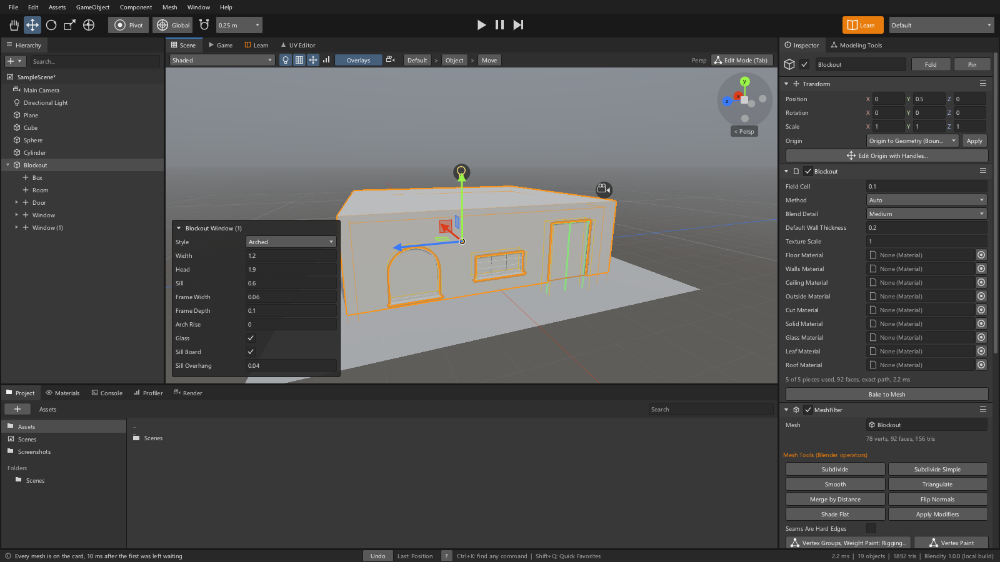
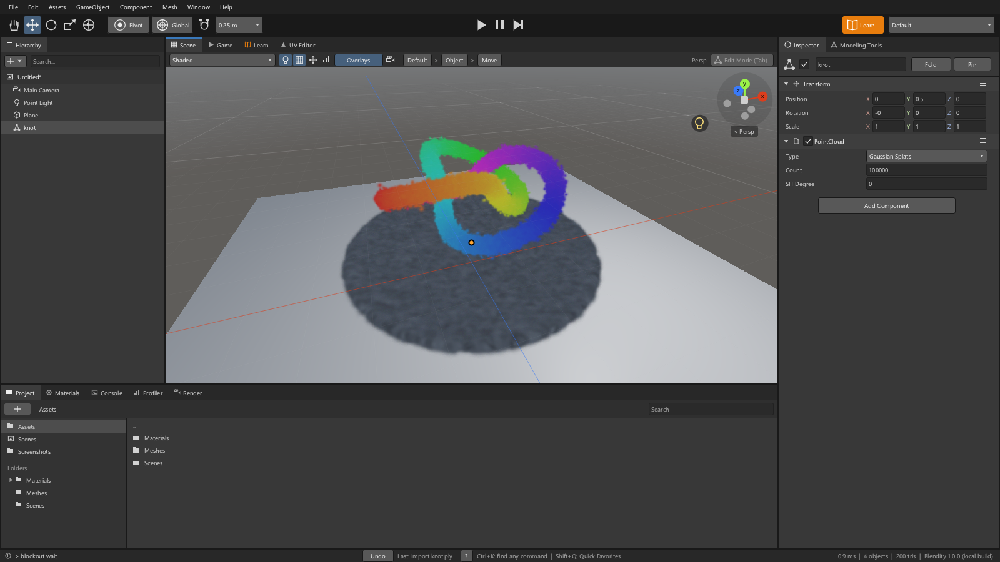
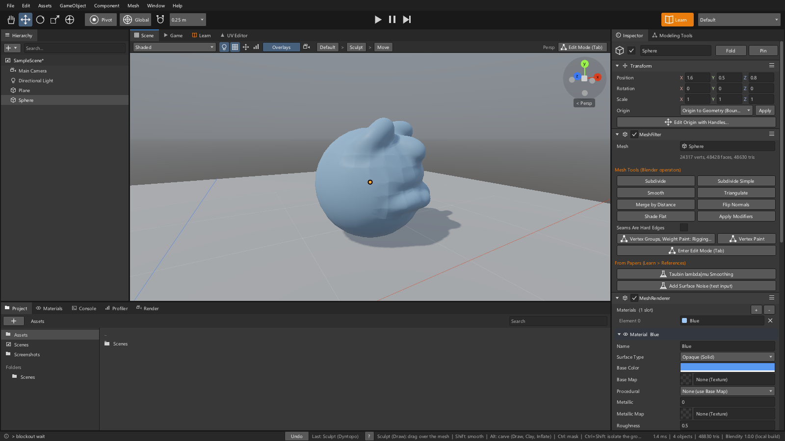
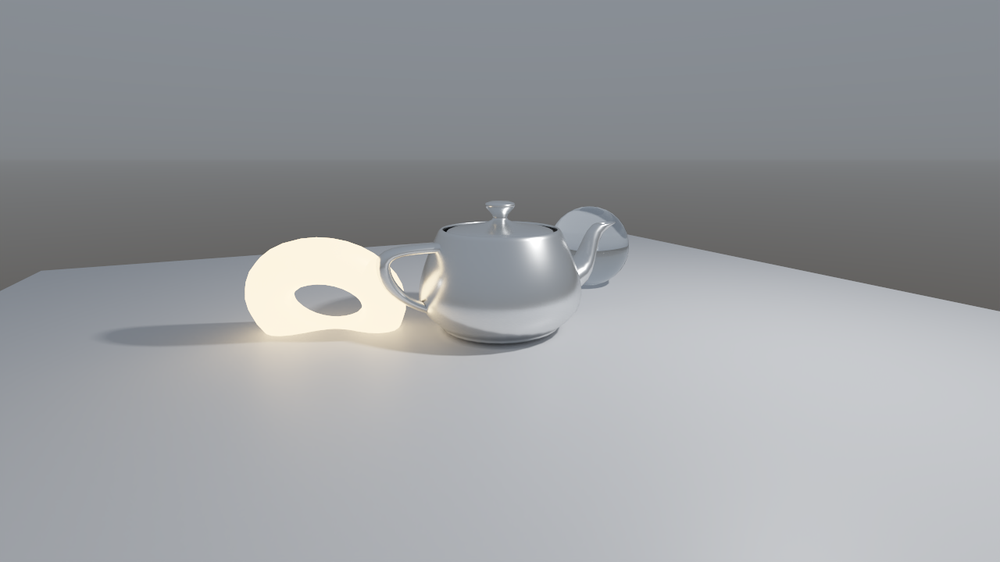

# Blendity

**Blender's modeling, UVs, materials, rendering, rigging and animation, driven like Unity.** Blendity is a free 3D
editor written in C++17. Its windows, navigation, shortcuts, Inspector and Play mode follow the Unity editor;
underneath, its meshes, Edit Mode tools, UV unwrapping, Principled materials, renderers, skins and IK follow Blender's
design and source code. A built-in **Learn** tab teaches each part with short interactive lessons.



| Gaussian splats in the Scene view | Sculpt Mode |
|---|---|
|  |  |



*The pictures are from the current build; the scenes are made by console commands.*

## Download

Blendity is free. You don't need Blender or anything else: the installer brings everything it uses.

| Your computer | Download |
|---|---|
| Windows 10 or 11 | **[Download for Windows](https://github.com/EmilianoManaloIV/blendity/releases/latest/download/Blendity-Setup-Windows.exe)** |
| Mac with an Apple chip (M1 or newer) | **[Download for Mac](https://github.com/EmilianoManaloIV/blendity/releases/latest/download/Blendity-macos.dmg)** |
| Linux (Ubuntu 22.04 or newer, Fedora, Mint...) | **[Download for Linux](https://github.com/EmilianoManaloIV/blendity/releases/latest/download/Blendity-linux-x86_64.AppImage)** |

Step-by-step install help for each system (including the "Windows protected your PC" and macOS first-run messages) is
in **[docs/INSTALL.md](docs/INSTALL.md)**. Every version is on the
[Releases](https://github.com/EmilianoManaloIV/blendity/releases) page. Macs with an Intel processor aren't supported.

## What you can do

- **Block out** rooms and buildings: Blockout pieces that add to or cut one mesh, rooms, styled doors and windows,
  stairs, arches and columns; SketchUp-style drawing and Push/Pull.
- **Model** with Blender's Edit Mode tools (extrude, inset, bevel, loop cut, knife), a modifier stack, and
  **sculpt** with brushes, DynaMesh and Dyntopo.
- **Unwrap and texture**: a UV Editor, Principled and toon materials, layered procedural textures, painting on the
  model, face-corner paint that survives mesh editing, and texture baking.
  Textures cards follow paint Undo and Redo (round 639).
- **Light and render**: a realtime rasterizer and a path tracer on the CPU or a Vulkan graphics card, baked
  lightmaps and probes, Gaussian splats (PLY, SPZ, glTF).
  The console reports unavailable camera view transforms and keeps the current view (round 657).
  Vulkan device creation supports the advertised portability subset (round 616).
  On Vulkan, mesh storage can be reused without disrupting baked lighting on other objects.
  The built-in CPU ray tracer uses less memory when preparing large splat clouds (round 629).
  The Lighting window shows the active update mode first and reveals the full bake counts on hover.
  Selecting Low releases oversized shadow planes in CPU viewports (round 631).
  Find and apply Low, Medium or High Viewport Quality from the command palette.
  The physical Sky world's Sun Elevation and Sun Rotation position its sun when there is no enabled Directional Light.
- **Rig and animate**: bones, IK, automatic weights, a dopesheet and curves, a Sequencer, walk cycles, spring bones.
- **Work with other tools**: import and export OBJ, FBX, glTF, STL, PLY and USD; Unity packages and scenes, VRM and
  MikuMikuDance characters; **Live Link** to Blender, Unity, Godot and Unreal.
  - **Steam Workshop**: [import installed characters and maps](docs/guides/workshop.md) from loose files or VPKs.
  Pose classic SFM characters with their bones and materials.
  Import classic BSP maps with terrain, brush models and placed props.
  Half-Life: Alyx and CS2 characters retain supported skins, materials and textures.
  Their compiled maps bring in world geometry and placed props.

The full list, stage by stage, is in **[docs/FEATURES.md](docs/FEATURES.md)**.

## Your first minute

1. Install and open Blendity. It starts in a sample scene; your work is saved in **BlendityProject** in your home folder.
2. Press **F1** for the **Learn** tab, or pick a stage from the **Layout** dropdown (top right).
3. **Alt+drag** orbits, the **wheel** zooms, **W / E / R** move, rotate and scale, **Tab** enters Edit Mode,
   **Ctrl+P** plays, and **Ctrl+K** finds any command by name.
   4. In Preferences, press **Tab** or **Shift+Tab** to move between controls. The field you are editing stays in view when settings change the layout.

## Learn more

- **[The manual](docs/MANUAL.md)** - the work stage by stage, with examples.
- **The Learn tab** (F1) - interactive lessons with Try-it buttons.
- **The books** (PDF, attached to every release): [User Guide](https://github.com/EmilianoManaloIV/blendity/releases/latest/download/Blendity-User-Guide.pdf) and
  [Architecture and Engineering](https://github.com/EmilianoManaloIV/blendity/releases/latest/download/Blendity-Architecture.pdf), each ending with the full reference list.
- **For developers:** [ARCHITECTURE.md](docs/ARCHITECTURE.md), [decisions/](docs/decisions/) (ADRs),
  [PERFORMANCE.md](docs/PERFORMANCE.md), [USABILITY.md](docs/USABILITY.md), [requirements.md](docs/requirements.md)
  and [AGENTS.md](AGENTS.md) (engineering standards and handoff).
- **Known limits and what changed** in each version: [CHANGELOG.md](CHANGELOG.md).

## Build from source

You only need a compiler; the small libraries Blendity copies from Blender are in `extern/`.

```bash
build.bat release all            # Windows: finds Visual Studio / Build Tools automatically
```
```bash
./build.sh release all           # Linux (g++ + libx11-dev) and macOS (Xcode command line tools)
```

Blender's prebuilt libraries (faster rendering, denoising, video export), CMake and the other options are in
**[docs/BUILDING.md](docs/BUILDING.md)**.

<!-- The unit-check count: the pass write-up updates this one line (tools/dev/changelog.py fold --checks). -->
Each build is tested: `blendity_tests` (142273 unit checks in 3965 tests with Blender's libraries), on Windows, Linux and
macOS by GitHub Actions.

## License

Source: **GPL-2.0-or-later**, the same as Blender (`LICENSE`). **Binaries are distributed under GPL-3.0-or-later**,
because they include libraries under other compatible licences; the details are in
[licenses/README.md](licenses/README.md) and the people and projects Blendity follows are named in
[CREDITS.md](CREDITS.md). Your scenes, meshes, textures and renders are yours.

Anthropic's Claude Code helped build Blendity through 1.0.0. Development continues with OpenAI Codex under the owner's direction and review. The program
itself runs no AI except an optional, local download. See [docs/AI_DISCLOSURE.md](docs/AI_DISCLOSURE.md).
