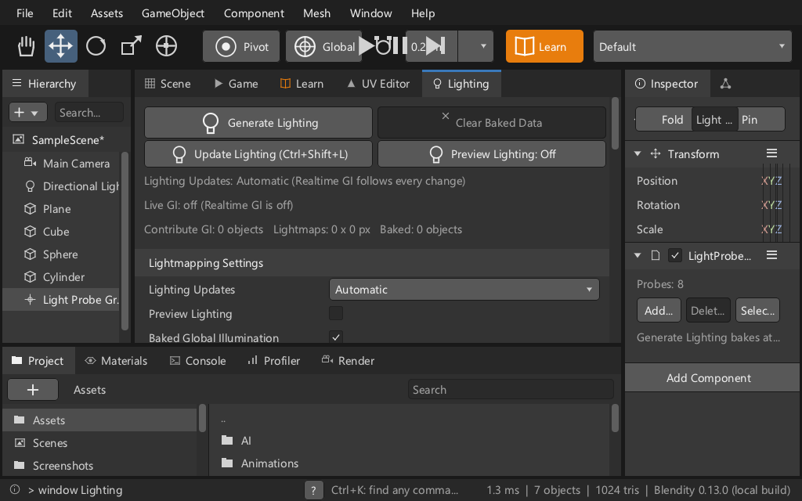
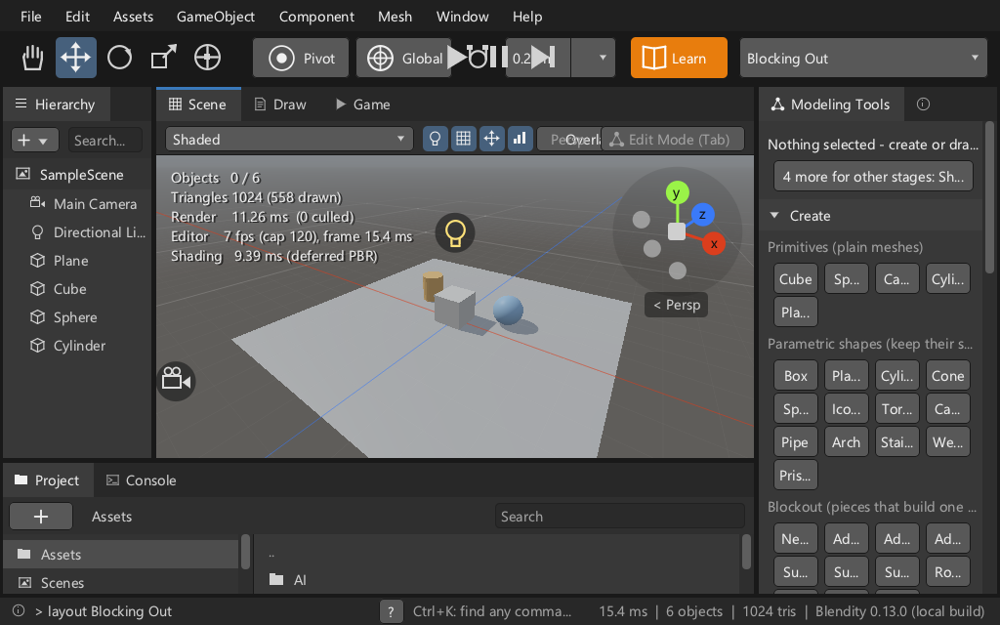
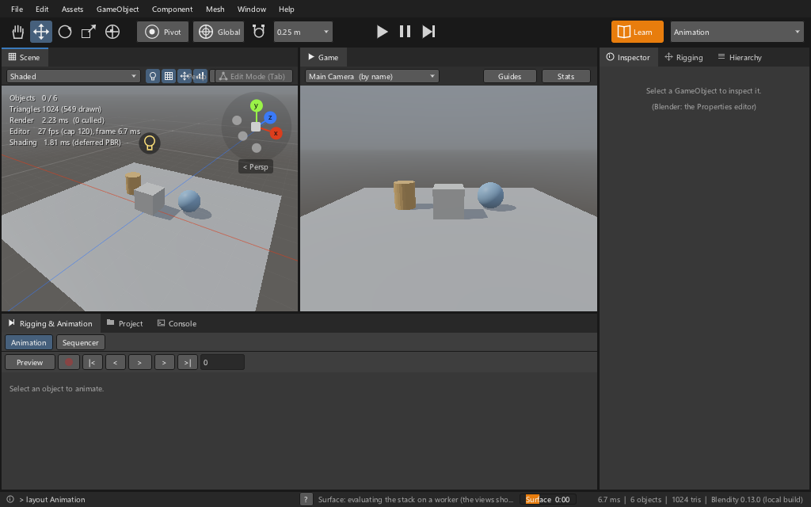
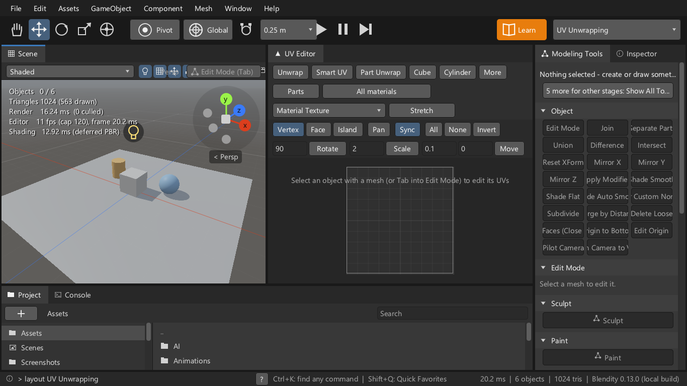
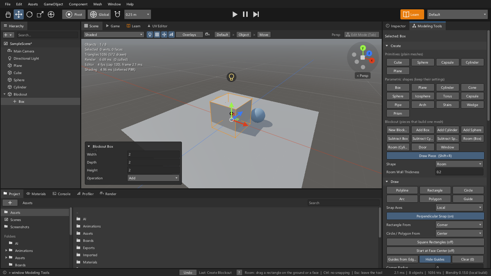

# The HCI survey of round 505 (Pass 25)

What is wrong with the interface on main at 8c1556b4, ranked by what an artist notices, with the round that takes
each finding. Nothing was fixed in this round: it measures. Task 0489.

## What was run
| Piece | How | Result |
|---|---|---|
| The live sweep, 12 configurations | `tests/test_hci.cpp` with `BLENDITY_SWEEP=full`: 1920x1080, 1366x768, 1024x640 x Dark, Light x UI scale 1, 1.5; every layout, window, menu, submenu, dialog, component Inspector and 15 scenario screens (Blockout, posing, lighting, Edit Mode, the palette) | 2,140 screens; about a minute without pictures, eight with a picture of each (413 MB, kept outside the repository; the five used here are in `sweep-505/`) |
| Keyboard reach and focus order (new) | The toolkit records the controls it draws (buttons, fields, checkboxes, dropdowns, sliders, colours, foldouts, menu rows), in drawing order, with its kind and whether Tab stops on it; a check with real key events walks the Inspector's and Preferences' fields | 11,508 controls drawn at 1366x768 x1, 1,810 with a keyboard stop (16 %); Tab order: 0 steps backwards in a column in all 12 configurations |
| One control on another (new) | Every recorded control against every other of its layer, whatever its kind | 18 distinct pairs; the old check saw labelled buttons only and found 6 |
| Small targets, named (new) | A control under 7 mm on its smaller side: 26 px at scale 1, 40 px at 1.5 | 9,288 of 9,783 controls on screen at 1366x768 x1 (95 %) - see finding 9 for what that number means |
| The static audits | `tools/hci_consistency_audit.py`, `hci_console_audit.py`, `hci_label_audit.py`, `hci_klm.py --check`, `hci_checklist.py --check` | consistency 0; **console 13 (baseline 1)**; **hard-coded shortcut labels 16 (round 274 took them to 0)**; KLM and checklist pass |
| The Fitts audit | `fitts-505.md`, from a fresh dump | 2,115 targets over 32 contexts at scale 1 (1,634 over 30 in round 282); 80 % under 7 mm (78 %) |
| The checklist | `checklist.json`: 20 tasks added for what came after round 313 - Blockout (R1-R12), lighting (I10-I15), posing (K14-K15); 141 tasks; each new one's screen opened headless as a scenario | every scenario opens; their faults are in the list below |
| Contrast | Every theme's text and dim text on its panel | all pass 4.5:1 (lowest: dim text 4.6 in Dark and Emiliano Light) |

The sweep's counts, distinct controls over the 12 configurations (`tools/hci_sweep_baseline.json` is rewritten to them):

| kind | round 313 (6 configurations) | round 505 (12 configurations, scenarios) |
|---|---|---|
| label cut (`elided`) | 15 | 49 |
| button without a tooltip (`no-tooltip`) | 16 | 11 |
| labelled buttons overlapping (`overlap`) | 3 | 6 |
| any control on another (`covered`) | not checked | 18 |
| names of controls without a keyboard stop (`no-key`) | not checked | 328 |
| names of targets under 7 mm (`small`) | counted only | 473 |
| popup outside the window, disabled button without a reason, Tab order backwards | 0 | 0 |

`no-key` and `small` count names: unlabelled controls of one kind (number fields, bare checkboxes, dropdowns) share
one, so the two rows are a floor, and the counts by kind in finding 1 are the measure.

The cut labels rose because six configurations were never looked at (1024x640 x1.5 alone shows 48 of the 49) and
because the Blockout buttons and the scenario screens are new; all 15 from round 313 are still there.

## The ranked list

### A. The task cannot be done

**1. The keyboard reaches one control in six.** Tab and Shift+Tab walk text and number fields, in the order they are
drawn, and nothing else. A button, a checkbox, a dropdown, a slider, a colour, a foldout cannot take the keyboard at
all; menus open by the mouse only and their rows do not follow the arrow keys; a dialog's buttons have no Enter or
Space. At 1366x768: 4,115 buttons, 2,841 icon buttons, 1,040 checkboxes, 852 dropdowns drawn across the screens, none
with a stop. What does work by keyboard: the shortcuts of the keymap, the command palette (Ctrl+K, arrows, Enter), the
Hierarchy's arrows, the Console's history, Esc closing a popup. *Round 509 - and question 1 below, because Tab is
Edit Mode over the Scene view.*

**2. The Inspector's Transform cannot be typed at 1024x640 with the UI at 1.5.** The X, Y and Z fields have no width
left: the three letters stand side by side with nothing between them. The sweep draws 119 number fields in that
configuration against 1,275 to 1,614 in the others. The object's name field is drawn under Fold at 1024x640 (both
scales) and at 1366x768 x1.5, on 126 to 128 screens, and under Pin as well at 1024x640 x1.5. *Round 509.*

**3. Play, Pause and Step are drawn on top of other toolbar buttons.** At 1024x640 x1.5 they cover Global, the
snapping toggle and the snap size on every screen (177 of 177). In Edit Mode they cover Proportional Editing at the
default size (1366x768 x1), Edge at 1024x640 x1, Face and Proportional Editing at 1920x1080 x1.5: the transport is
centred on the window and the toolbar's left group has grown past the centre. A click there goes to one of the two.
*Round 509.*

### B. The task is slowed or misread

**4. The Scene view's header writes on itself when the view is narrow.** "Persp" and the Edit Mode (Tab) button are
drawn over Overlays and the view toggles when the Scene view is under about 520 px wide: 1024x640 at either scale,
1366x768 at 1.5, and every two-view layout (Animation, UV Unwrapping). The header's labels are drawn by hand, so only
the pictures show it. *Round 509.*

**5. 49 labels are cut.** 38 are in this stream's windows, 11 are Blockout's Create buttons (finding 14).
- At the default size: Guides from Edges (1 px short), Update Lighting (Ctrl+Shift+L) in a side pane.
- In the Modeling Tools' Object grid the label is centred and cut at both ends with no "..." - "pply Modifie",
  "rge by Distar", "igin to Botto" - at 1366x768 x1.5 and 1024x640 x1.5: that grid does not use the toolkit's
  ellipsis.
- At 1024x640 x1.5 the Create grids keep four columns and every label is two letters and an ellipsis ("Sp...",
  "Ca...", "Cyli..."): the grid should drop columns before it cuts.
- The rest: Lighting (Generate Lighting, Clear Baked Data), Live Link's three Project... buttons, Layers (New Layer,
  Merge Down, Duplicate, Add Mask, Delete Mask, Group, Flatten, Delete), Rigging (Add Armature, Humanoid Rig,
  Quadruped Rig, Apply as Rest), the Light Probe Group's Add Probe / Delete Selected / Select All, the Inspector's
  Edit Origin with Handles..., Merge by Distance, Subdivide Simple, Flip Normals.
*Round 509.*

**6. The status bar's job tray is drawn over the status hint** (the orange "Surface 0:00" on the hint's text in the
picture under finding 4) and is the smallest target in the program: 72 x 14 px. *Round 509.*

**7. 13 texts send the artist to the Console** (the audit's baseline was 1): the Avatar window's Fix Model and lip
sync help, Decimate to fit, the Lights Gamma toast, the UI file's help, the CPU-view note, a polygon's sides, the
Surface ID map toast, VR paint, Unbake's help - and three in Blockout's files (finding 14). Each should name the
control instead. *Round 510.*

**8. 16 shortcut labels are written into strings** and are wrong in any keymap but the default: the board's Ctrl+V,
the Draw tool's and the Project view's "(Tab)", the Sequencer's Alt+B and Shift+Del, the sketch pad's Ctrl+Z / Ctrl+Y
(four places), the sketch selection's Alt+Backspace, Ctrl+D, Ctrl+T and its transform help, the snapshot's Ctrl+Z, the render view's F12.
The list is `labels-505.md`. *Round 510.*

**9. Small targets: the number needs reading before it is fixed.** At mouse density a row is 20-22 px, so nearly
every control is "under 7 mm" (95 %); in Tablet Mode the whole interface is half as big again (30-33 px) and passes.
What is wrong in either mode is what is smaller than a row:
- the job tray, 14 px high;
- a bare checkbox, 15 px wide (1,038 of them on the swept screens - its row is clickable only where `toggle_row`
  draws it);
- the Scene and Game views' header strip, the status bar's buttons, the breadcrumbs, the Console's Clear and
  Collapse, the search fields: 18 px high, so 27 px in Tablet Mode - but a checkbox is 22 px there, and the tray 21.
*Round 509 for those; whether mouse density itself should grow is question 2.*

**10. 11 buttons have no tooltip:** Render Animation (Ctrl+F12), Open the Avatar Window, the Animation / Sequencer and
Materials / Textures member rows, the Animation window's Create, four rows of the Profiler. *Round 509.*

**11. Controls on each other, beside findings 2 and 3:** the Draw window's More over its size field and colour; the
Game view's camera dropdown over Guides and Stats at 1.5; Overlays over Unwrap in the UV Unwrapping layout at 1.5;
Sculpt under the "+1" overflow in the Stylized layout. *Round 509.*

**12. Three of the old overlap check's six findings are not faults:** T-Pose / Undo and A-Pose / ? (a button
scrolled out of the Avatar window, compared with the status bar where it would have been) and Subdivide / Install...
(the Inspector under a dialog). The check should use the clip a control was drawn under, as the new ones do.
*Round 509, in the test.*

**13. Smaller things seen in the pictures.** Preferences' Animation Assistants: the first checkbox row is indented
differently from the four under it, and "not installed (Install...)" stands beside a button named Install... . The
Animation window's transport has two buttons both labelled ">". *Round 510.*

### C. Another stream's

**14. Blockout (stream 1, Pass 23b).** Four Create buttons are cut at the default size - New Block..., Subtract
Cy..., Subtract Sp..., Room (Cyli... - and eleven in the tighter configurations (Add Box / Cylinder / Sphere,
Subtract Box / Cylinder / Sphere, Room (Box), Room (Cylinder), New Blockout, Door, Window). Three texts send the
artist to the Console: `blockout_editor.cpp:1605` (Turn 90's help), `blockout_tool.cpp:534` and `:613` (the
Operation). `editor.cpp:1339` (Unbake's help) names a console command too.

### D. What is right
- No popup leaves the window and no disabled button is silent about why, in any configuration.
- Tab order: no step goes backwards within a column on any screen (a step to another column or window is not judged); Tab and Shift+Tab land on each field in drawing order (checked
  with real key events on the Inspector's 10 fields and Preferences' 7).
- Contrast passes in all five themes; Dark and Light give the same findings, so nothing depends on the theme.
- The consistency audit (ellipsis, Title Case, spelling, tooltips ending a sentence) is at 0.
- At 1920x1080 x1 no label is cut.

## Questions for the user
1. **How does the keyboard get into a window's controls?** Tab is Edit Mode over the Scene view and commits a field
   elsewhere, so it cannot simply walk every control everywhere. Proposed: in a dialog or a popup Tab walks every
   control at once (nothing else wants the key there); in a docked window Tab carries on from a field to the buttons,
   checkboxes and dropdowns after it, and F6 puts the focus on the first control of the window under the pointer,
   then of the next window; Alt or F10 focuses the menu bar and the arrows walk the menus; Space or Enter presses,
   Esc lets go; a focus ring in the theme's focus colour shows where it is. Tab with nothing focused stays Edit Mode.
   The other way: Tab walks controls whenever the pointer is not over the Scene view - simpler to say, but Tab then
   means two things depending on where the mouse happens to be.
2. **Should controls grow at mouse density?** Proposed: no - keep 20-22 px rows for the mouse, make every target at
   least 7 mm in Tablet Mode, and bring what is smaller than a row up to a row in both. The other way: 26 px rows
   everywhere, which shows about a fifth fewer rows in every Inspector and list.

## Where each number comes from
- The sweep: `BLENDITY_SWEEP=full BLENDITY_SWEEP_OUT=<file> BLENDITY_SWEEP_SHOTS=<folder>` with
  `BLENDITY_TEST_FILTER="the live sweep"`, `--group hci`; then `py tools/hci_sweep.py <file>` for the tables and
  `--check` against the baseline. Numbers here are the Windows build with Blender's libraries.
- The keyboard table: the same run prints it ("keyboard reach, per configuration").
- The audits: each tool with no arguments; `fitts-505.md` and `labels-505.md` are their reports.
