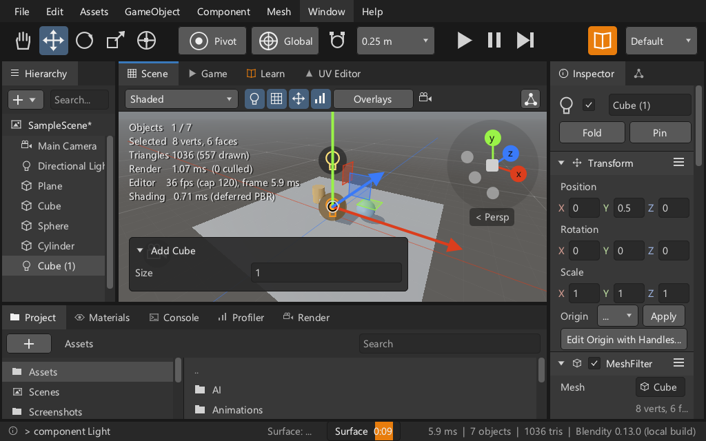
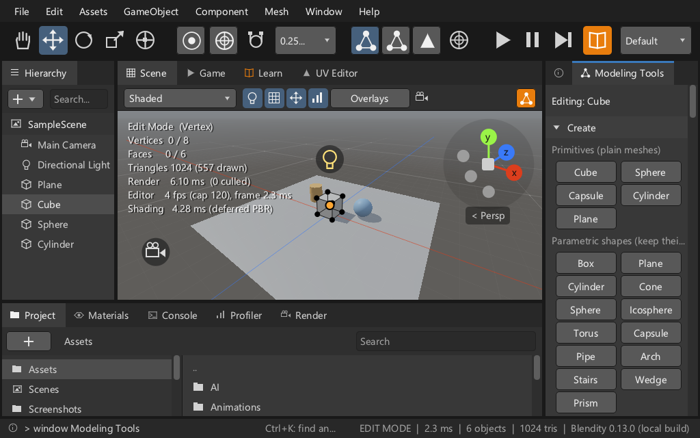
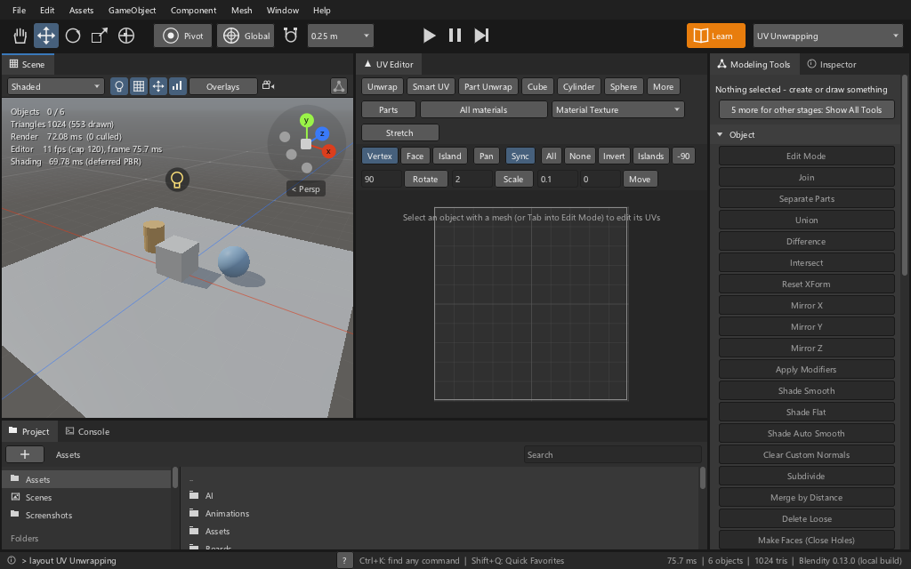

# The sweep's faults to zero (round 509, Pass 25)

Round 505's survey (`sweep-505.md`) listed what the live sweep finds in all 12 configurations - three sizes
(1920x1080, 1366x768, 1024x640) x Dark, Light x UI scale 1, 1.5. This round fixes the list's top and turns the
sweep's counts into checks. The owner's two answers of 2026-11-14 ("A & A") are in `docs/tasks/0493-hci-faults-to-zero.md`
and ADR 0145.

## Before and after

The same sweep, 2,140 screens, Windows with Blender's libraries. Distinct names per kind, over every screen
(Blockout's scenario screens included).

| kind | round 505 | round 509 | what changed |
|---|---|---|---|
| `no-key` (a control the keyboard cannot stop on) | 328 | **0** | keyboard focus for every toolkit control (ADR 0145) |
| `covered` (a control lying on another) | 18 | **0** | the toolbar, the Scene and Game headers, the Inspector's header, the job tray, the Draw toolbar, the tab overflow |
| `overlap` (labelled buttons, the old check) | 6 | **0** | three were real (fixed with `covered`); three were the check's mistake - it now compares what each control's clip lets through |
| `elided` (a cut label) | 49 | **2** | grids drop columns, pairs of buttons wrap, a word keeps its place before its icon; the two left are below |
| `no-tooltip` | 11 | **0** | each has one |
| `small` | 473 (under 7 mm at every scale) | **0** (as decided) | see "Targets" |
| `tab-order` (a step backwards in a column) | 0 | **0** | the order now covers every kind of control, not only fields |
| `popup-outside`, `disabled-no-reason`, `clipped` | 0 | 0 | |

Keyboard reach at 1366x768 x1: 11,445 of the 11,493 controls drawn have a stop (1,810 of 11,508 in round 505). The 48
without one are disabled menu rows, which the arrows step over.

`tools/hci_sweep_baseline.json` is now `{"elided": 2}`; `py tools/hci_sweep.py <sweep.json> --check` fails on anything
more. The suite's own configuration (1366x768 Dark x1, in every run of the `hci` group) asserts **zero** for `elided`,
`no-tooltip`, `overlap`, `covered`, `no-key`, `small` and `tab-order` and prints the name and screen of whatever it
finds; Blockout's scenario screens are left to their own stream there (they are at zero today as well).

## What the keyboard does now (ADR 0145)

- **F6** puts the focus on the first control of the window under the pointer; again, on the next window's; Shift+F6
  the previous one. **F10**, or Alt pressed and let go alone, focuses the menu bar.
- With a control focused: **Tab** / **Shift+Tab** walk every control in drawing order (inside a dialog or popup the
  walk stays there and wraps; in a dialog or popup a bare Tab starts it); **Space** or **Enter** presses a button,
  ticks a checkbox, opens a dropdown or a colour, folds a foldout; **Left** / **Right** step a slider; the arrows walk
  menus and lists; **Esc** lets go.
- With nothing focused Tab is still Edit Mode and every shortcut is the keymap's. A mouse press drops the focus.
- The ring is the theme's focus colour with a one-pixel outline in the text colour: the themes' own focus colours are
  2.4 to 2.7:1 on the panel in three themes and were not changed; the outline carries the contrast.

Known edges: a modal tool started by its shortcut while a control is focused (G, Push/Pull, Bevel) lets the focus
go - Enter, Esc and Space are the tool's; while a field is being edited, F6, F10 and Alt wait until Esc or Enter; the Hierarchy's and Project's
rows, the Console, the timeline and the Scene view keep their own keys and are reached by F6 landing in their window;
widgets a window draws by hand are not stops (round 510 lists them).

## Layout fixes, by the survey's numbers

- **2 - the Inspector at narrow widths.** Position, Rotation and Scale put their three fields on a row of their own
  under the label when the label's column leaves them less than four digits each; the name field keeps its row and
  Fold and Pin go under it. A property row's field keeps at least 48 px (72 px in Tablet Mode) and the label gives
  way with its ellipsis - the Type, Color and Intensity fields of a Light were 22 px wide. Origin's dropdown starts
  right after its word where its column left it nothing.
- **3 - the toolbar.** Play, Pause and Step stand at the window's centre or right of the left group, whichever is
  further right; the right group shrinks first; in Edit Mode at 1024x640 x1.5 the left group compacts in steps
  (Vertex / Edge / Face as icons, then Pivot and Global as icons, then a narrower snap size). No toolbar control lies
  on another in any configuration.

- **4 - the Scene view's header.** As the view narrows the shading dropdown narrows (170, 110, then 80 px) and the
  header leaves out the "Persp" word, the Edit Mode button's label (the icon stays) and, narrowest, the four quick
  toggles (they are in Overlays); nothing is drawn over a button. Overlays no longer lies on
  Unwrap in the UV Unwrapping layout.

- **6 - the job tray, the Draw toolbar, the Game view's header, the tab overflow.** The tray takes what the status
  hint leaves; the Draw window's More is its icon in a side pane and the brush group shrinks to floors (the word
  "Size", then the size field itself, give way - the palette's puck sets the size); the Game view's camera dropdown
  ends before Guides and Stats; a tab strip keeps room for its "+N".
- **5 - cut labels.** A grid of buttons (`Editor::button_grid`, `ui::Context::button_cells`) drops columns until its
  widest label fits and never gives a caller more columns than it asked for; pairs and triples of buttons (Lighting,
  Live Link, Layers, Rigging, Light Probe Group, MeshFilter, the shape keys, the Draw palette's footer) go side by
  side when they fit and one under the other when they do not; a button whose word fits only without its icon keeps
  the word; Update Lighting leaves its key to the tooltip in a narrow pane. This also took the 11 cut labels of
  Blockout's Create buttons to none, through the shared grid - their own relabelling is stream 1's round 499.
- **10 - tooltips:** the 11 buttons without one have one.

## Targets (the owner's decision)

Mouse density stays: a row is 20 to 22 px, by the font. A recorded target must be at least 20 px - the lower of
those rows - on its smaller side at scale 1, and 7 mm - 26 px on a 96 dpi screen - at UI scale 1.5, which is the
scale Tablet Mode sets (Tablet Mode multiplies the UI scale by 1.5; the sweep's x1.5 configurations stand for it,
and three controls are also checked with Tablet Mode itself switched on). Between the two scales the limit is
20 px scaled, at most 26 px. Raised to a row: the job tray, a bare checkbox's hit area (the box is drawn as before), the Scene and Game
headers, the status bar's buttons, the breadcrumbs, the Console's and Hierarchy's strips, Preferences' Install /
Remove buttons. The sweep still prints how many targets are under 7 mm at each scale (the Fitts audit's ground,
`fitts-505.md`): that count is not a fault by the decision.

## What moved at the default size

Part D's rows are visible at 1366x768 and 1920x1080, scale 1, too: the Scene, Game, Hierarchy, Console, Project,
Materials and Textures strips are 2 px taller, and a three-number row's letters and gaps are 1 to 2 px tighter (so
four digits fit sooner). Nothing else moves there.

## What is left

| what | where | owner | why it stays |
|---|---|---|---|
| "Generate Lighting" (116 px of label in 110 px) and "Clear Baked Data" (111 in 110) end in "..." | the Lighting window docked in the left pane at 1024x640 x1.5 only | this stream | the pane is about 150 px wide there; the label is longer than the window can give it. The tooltip says it whole. |
| "Edit Origin with Handles..." ends in "..." | the Inspector at 1024x640 x1.5 | this stream | about 240 px of label in a 200 px pane, on a row of its own; the tooltip says it whole. (The sweep's cut-label check reads labelled buttons by their whole label, so a label that itself ends in "..." is not in its list.) |
| A long label takes its whole grid to one column | the Modeling Tools' Object grid in a 215 px pane ("Make Faces (Close Holes)") - 20 rows instead of 10 | this stream; a choice | the other way is the cut labels of round 505. Shorter labels would give the columns back: a wording choice for the owner. |
| The Game view's camera dropdown is left out when its header has under 60 px for it | a Game view narrower than its Guides and Stats buttons and that | this stream, round 510 | the camera can still be picked in the Hierarchy; a dropdown as an icon would be the fix |
| With a control focused in a docked window, Tab past the window's last control walks on through the other windows, the status bar and the menu bar | every docked window | by ADR 0145 (order is drawing order); Shift+F6 / F6 jump by window | |
| The Sequencer's toolbar runs past its pane at 1024x640 x1.5 and is cut there | Sequencer window | this stream, round 510 | not a control on another (the clip cuts it); its last buttons cannot be reached there. |
| Widgets drawn by hand (`mark_widget`, `text_area`, `drag_label`, `curve_field`, `color_ramp`) are not recorded and are not keyboard stops | several windows | round 510 | they are not the toolkit's calls |
| Texts that send the artist to the Console (13), shortcut labels written into strings (16), Preferences' rows and the two ">" buttons | survey findings 7, 8, 13 | round 510 | |

## Where each number comes from

- The sweep: `blendity_tests --group hci` with `BLENDITY_TEST_FILTER="the live sweep"`, `BLENDITY_SWEEP=full`,
  `BLENDITY_SWEEP_OUT`, `BLENDITY_SWEEP_SHOTS` (about six minutes with pictures); `py tools/hci_sweep.py <file>`.
- Round 505's column: `sweep-505.md`. The dependency-free build and Linux have other fonts: their suite
  configuration asserts the same zeros; the 12-configuration table above is the Windows build with the libraries.
