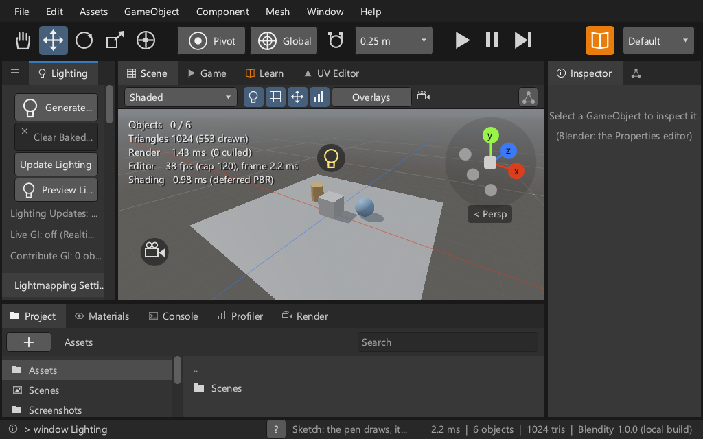

# Round 590 HCI sweep

The [task spec](../tasks/0572-hci-sweep.md) covers U-01 through U-07. The [checklist evidence map](sweep-590-checklist.md) assigns all 141 checklist rows to eight workstreams and preserves their 18 original groups.

## Revisions and method

- Source reviewed at `62854e5b`. The Windows libraries test executable was the tested PR #480 build at `22ead0eb6f953a2006d17813e94ae0da3f5bb1b7`, SHA-256 `14de7f1a8b8e944312863f77d47be20ab688302a23b2c3f0050b936a406d1c18`. The revisions have identical `src/` and `tests/` contents.
- The live matrix uses 1920×1080, 1366×768 and 1024×640 at UI scales 1 and 1.5 in Dark and Light. The test runs beside its packaged libraries and shaders. The Windows UI font search started at Segoe UI (`segoeui.ttf`, SHA-256 `704eada12961a27fd271f7d3b09e2066520e758390c1776744eff430fee30f6e`) with no `BLENDITY_FONT` override. The runner does not log the selected font source. Every run has its own scratch project, trash, preferences, cache, outputs and screenshots.
- The required U-01 minimum is 20 px at scale 1 and 26 px at scale 1.5. The separate 7 mm report counts controls under 26 and 40 px respectively, following the live test's scale-adjusted Fitts calculation. These counts describe the available targets at pen density.
- The live sweep checks control presentation and emits keyboard reach by configuration. Focused HCI checks cover dim text and the keyboard focus ring. Checklist actions requiring a native client, a physical pen, optional AI or a timing window have their limitations recorded in the evidence map.

## Static checks

All commands ran with Windows Python 3.14 in scratch and returned zero.

| Check | Result |
| --- | --- |
| `tools/hci_label_audit.py --check` | 0 hard-coded shortcuts flagged in editor labels |
| `tools/hci_consistency_audit.py --check` | 0 findings, baseline 0 |
| `tools/hci_klm.py --check` | 28 timed model rows agree with their operator sequences, with historical totals of 184.65 s before and 96.45 s after |
| `tools/hci_console_audit.py --check` | 6 suggestions to use the Console, equal to the baseline |
| `tools/hci_checklist.py --check` | 141 items in 18 original groups, with 0 missing listed control names |

## Live results

The test completed 2,156 screens and saved 2,156 PNGs across all 12 configurations. The live sweep, focused dim-text and focus-ring checks passed with 7, 9 and 10 checks respectively. The baseline comparison passed. The report counted 18 elisions across 7 distinct labels and 14,142 occurrences of the 3 XYZ handles. It reported zero new control findings above the baseline, including zero `small`, `covered`, `overlap`, `clipped`, `popup-outside`, `no-tooltip`, `disabled-no-reason`, `no-key` and `tab-order` findings.

Each line applies to Dark and Light separately. Both themes had identical counts for the same size and scale. The two control counts come from separate parts of the audit. The 7 mm column is the size report, and the keyboard column includes all recorded types.

| Resolution | UI scale | PNGs | Elisions | Targets below 7 mm / sampled | Controls / keyboard stops | Hand-drawn controls without a stop |
| --- | ---: | ---: | ---: | ---: | ---: | ---: |
| 1920×1080 | 1 | 182 | 0 | 10,335 / 10,988 | 15,163 / 13,481 | 1,627 |
| 1366×768 | 1 | 182 | 0 | 8,745 / 9,184 | 13,063 / 11,653 | 1,355 |
| 1024×640 | 1 | 182 | 0 | 7,024 / 7,460 | 11,442 / 10,038 | 1,349 |
| 1920×1080 | 1.5 | 182 | 0 | 8,629 / 9,050 | 12,791 / 11,384 | 1,352 |
| 1366×768 | 1.5 | 180 | 1 | 5,981 / 6,395 | 10,419 / 9,048 | 1,317 |
| 1024×640 | 1.5 | 170 | 8 | 3,724 / 4,110 | 8,375 / 6,894 | 1,428 |

Tab-order breaks were zero in every configuration. The known hand-drawn controls remain a separate keyboard-reach gap under U-04. Their counts include repeat observations of a control in different scenes or windows.

| Theme | Text contrast | Dim text contrast | Focus outline contrast |
| --- | ---: | ---: | ---: |
| Dark | 7.8:1 | 4.6:1 | 7.76:1 |
| Light | 11.4:1 | 4.8:1 | 11.37:1 |
| Emiliano Light | 12.6:1 | 4.6:1 | 12.56:1 |
| Emiliano Dark | 12.6:1 | 5.1:1 | 12.56:1 |
| High Contrast | 19.0:1 | 11.4:1 | 19.03:1 |

The dedicated focus check sampled all four sides of a focused control and the outside outline. The focus colour alone was below 3:1 in three themes. The text-colour outline exceeded 3:1 in all five themes.

## Ranked findings

1. **The checklist's Extrude step invokes Rotate in the default keymap.** In a fresh profile select a cube, enter Edit Mode, and select a face. D2 says to press E. Unity is the default preset and binds E to Rotate and Ctrl+E to Extrude. Blender binds E to Extrude, so explicitly naming the action and preset lets both readers follow the route. The adjacent navigation and animation examples should also name the preset where they give a specific chord. Draft task 0573 records the checklist follow-up.
2. **Lighting's mode and object counts disappear in the narrow pane.** Open Window > Lighting at 1024×640, Dark, UI scale 1.5. The status row shows `Lighting Updates: …`, hiding Manual or Automatic. The Contribute GI summary cuts off the object and lightmap counts. Both use the plain label widget, which elides and has no automatic tooltip. The Lighting window does not attach a tooltip to either row. Recovering the mode requires scrolling to the actual setting. The automated button audit does not detect these passive status labels. Approved task 0574 covers the Lighting fix.

   

## Existing baseline findings

The seven elided labels match the [previous sweep](sweep-509.md#what-is-left). Lighting accounts for Generate Lighting and Clear Baked Data. Avatar accounts for Delete Zero Weight Bones, Separate by Material, Separate Loose Parts and Separate by Shape Keys. Rigging accounts for Anime Face Normals (Ellipsoid), which also appears in the humanoid rigging scenario. The button widget exposes the full label on hover. XYZ vector handles retain their separate `small-handle` classification because the adjacent number fields provide full targets.

The raw run log, JSON findings and all screenshots remain in the hub's local scratch run. The checked-in image is the unmodified screenshot for the newly reported Lighting status issue.
